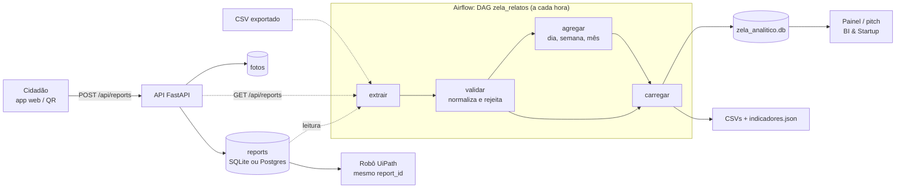

# data: Big Data Architecture & Data Integration

A DAG `zela_relatos` do Airflow transforma os relatos brutos da aplicação (tabela `reports`) em tabelas analíticas do piloto. Ela usa o mesmo `report_id` da aplicação e não cria cadastro paralelo.

## Arquitetura



| Camada | Tecnologia | Responsabilidade |
| --- | --- | --- |
| Ingestão | API FastAPI | Recebe o relato, valida o formato, grava em `reports` |
| Armazenamento bruto | SQLite (dev) ou Postgres (Docker/nuvem) | Fonte da verdade, com o `report_id` |
| Orquestração | Airflow 2.10 (DAG `zela_relatos`, `@hourly`) | Agenda, refaz até 2 vezes em caso de falha e registra os logs de cada tarefa |
| Transformação | [`dags/zela_pipeline.py`](dags/zela_pipeline.py), só com a biblioteca padrão | Extrai, valida, normaliza e agrega |
| Camada analítica | `zela_analitico.db` + CSVs | Tabelas `relatos_limpos`, `relatos_rejeitados`, `agregado_periodo` e `execucoes` |

As tarefas trocam dados por arquivos JSON numa pasta de trabalho por execução (`saida/_trabalho/<run_id>/`). O XCom leva só os caminhos, para não guardar dados no banco de metadados do Airflow.

O dicionário de dados de todas as tabelas está em [DICIONARIO_DE_DADOS.md](DICIONARIO_DE_DADOS.md).

## Regras de validação e normalização

| Campo | Normalização | Rejeita quando |
| --- | --- | --- |
| `id` | Inteiro | Ausente, não numérico ou repetido |
| `location` | Espaços extras removidos | Vazio ou com menos de 3 caracteres |
| `category` | Minúsculas, sem acento, `_` como separador. Sinônimos: `buraco` e `rachadura` → `dano_na_pista`, `calcada_quebrada` → `calcada`, `bueiro_entupido` → `bueiro` | Fora das 6 categorias do contrato |
| `status` | Igual a `category`. Valores da API antiga: `novo` → `recebido`, `protocolado` → `encaminhado`. Também `Em Triagem` → `em_triagem` | Fora dos 4 status do contrato |
| `source` | Vazio → `cidadao`, `simulado` → `demo` | Diferente de `cidadao` e `demo` |
| `created_at` | ISO 8601 em UTC (sem fuso = UTC, como a API grava) e as colunas `dia`, `semana` (ISO) e `mes` | Ilegível, mais de 10 minutos no futuro ou anterior a 01/01/2026 |
| `latitude`, `longitude` | Número | Nunca rejeita: par incompleto ou fora da faixa vira nulo e o relato continua |

O `confirm_token` e o nome da foto **não são extraídos**. O token é segredo do cidadão e a foto não entra na análise.

## Como executar

**1. Gerar os dados de demonstração** (na pasta `api/`, no mesmo banco da API):

```bash
cd api
DATABASE_URL=sqlite:///../.dev/dev.db UPLOAD_DIR=../.dev/uploads .venv/bin/python -m app.demo --quantidade 40
```

Todos saem com `source = demo` e a descrição começa com "[demonstração]". Para remover, use `--apagar`.

**2a. Airflow com interface** (http://localhost:8080):

```bash
cd data
mkdir -p airflow saida
AIRFLOW_UID=$(id -u) docker compose -f docker-compose.airflow.yml up
```

Na primeira vez, o usuário `admin` e a senha aparecem no log e ficam em `data/airflow/standalone_admin_password.txt`, fora do git. Ative a DAG `zela_relatos` e use **Trigger DAG** para rodar. Para ler da API no ar em vez do SQLite, defina `ZELA_FONTE=https://<url>/api/reports`.

**2b. Uma execução direto pelo terminal** (foi assim que as evidências foram geradas):

```bash
cd data
docker run --rm --user "$(id -u):0" -e AIRFLOW__CORE__LOAD_EXAMPLES=false -e ZELA_SAIDA=/opt/zela/saida \
  -v "$PWD/airflow:/opt/airflow" -v "$PWD/dags:/opt/airflow/dags:ro" -v "$PWD/saida:/opt/zela/saida" \
  -v "$PWD/exemplos:/opt/zela/exemplos:ro" -v "$PWD/../.dev:/opt/zela/app:ro" \
  apache/airflow:2.10.5-python3.12 bash -c "airflow db migrate && airflow dags test zela_relatos 2026-11-10"
```

Para rodar com o CSV de exemplo com erros, troque o final por:

```bash
airflow dags test zela_relatos 2026-11-10T01:00:00 --conf '{"fonte":"/opt/zela/exemplos/relatos_brutos_exemplo.csv","saida":"/opt/zela/saida/exemplo_csv"}'
```

**Sem Airflow**, para testar o pipeline:

```bash
cd data/dags
python3 zela_pipeline.py --fonte ../exemplos/relatos_brutos_exemplo.csv --saida ../saida/teste
```

**Testes:**

```bash
cd data
../api/.venv/bin/python -m pytest -q tests   # o pipeline só precisa da biblioteca padrão e do pytest
```

## Evidências (execuções de 10/11/2026)

| Arquivo | O que mostra |
| --- | --- |
| [`evidencias/execucao_banco_dev.log`](evidencias/execucao_banco_dev.log) | DAG no banco da API: 41 relatos lidos (40 demo), 41 válidos, 77 linhas agregadas, `state=success` |
| [`evidencias/indicadores_banco_dev.json`](evidencias/indicadores_banco_dev.json) | Indicadores dessa execução: 95% confirmados pelo cidadão, 97% de concordância da visão, 49% encaminhados (dados simulados) |
| [`evidencias/execucao_csv_exemplo.log`](evidencias/execucao_csv_exemplo.log) | DAG no [CSV com erros](exemplos/relatos_brutos_exemplo.csv): 14 lidos, 5 válidos e 9 rejeitados, cada um com o motivo |
| [`evidencias/rejeitados_csv_exemplo.csv`](evidencias/rejeitados_csv_exemplo.csv) | A tabela de rejeitados gerada nessa execução |

Para o PDF da disciplina ainda faltam os prints da interface do Airflow (grafo da DAG e log de uma tarefa), tirados com a opção 2a.

## Limitações

- Os números das evidências vêm de dados **simulados** e servem para demonstrar o pipeline, não para medir o piloto.
- A carga é completa a cada execução, com as tabelas recriadas. Isso basta para o volume do piloto. Com volume maior, o caminho seria carga incremental por `created_at`.
- A fonte padrão lê o SQLite de desenvolvimento. Em produção, a DAG deve ler pela API ou por um usuário somente leitura do Postgres.
