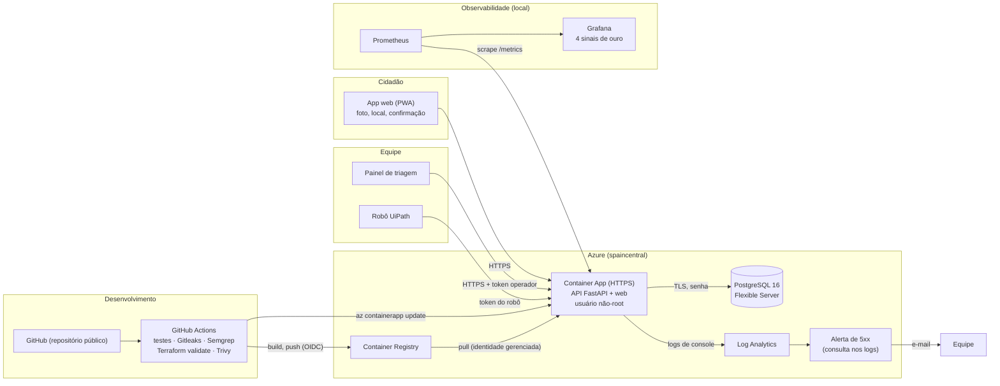

# Arquitetura de produção e responsabilidade compartilhada

Documento da disciplina de Secure DevOps & Cloud. O texto explica o que roda onde, como o código chega à produção e quem responde por cada camada.

## Diagrama

A infraestrutura inteira é criada por Terraform (`infra/terraform/`). O pipeline só publica a imagem; ele não altera a infraestrutura.

## Fluxo de entrega

1. Um push na `main` dispara o workflow `ci`.
2. Rodam em paralelo: testes (pytest), Gitleaks (segredos no histórico), Semgrep (análise estática de Python e Dockerfile) e `terraform validate`.
3. Depois dos testes, o Trivy varre a imagem e **reprova** o pipeline se houver vulnerabilidade HIGH ou CRITICAL com correção disponível.
4. Só se tudo passar, o job `deploy` faz login no Azure por OIDC (sem senha guardada), publica a imagem no ACR com o SHA do commit e atualiza o Container App. Um teste de fumaça confere o `/health`.

## Responsabilidade compartilhada

| Camada | Quem responde | O que a equipe faz |
| --- | --- | --- |
| Datacenter, hardware, rede física, hipervisor | Microsoft | Nada. Escolher a região (`spaincentral`) por política da assinatura |
| Plataforma gerenciada (Container Apps, PostgreSQL Flexible Server, ACR, Log Analytics) | Microsoft: disponibilidade, patches do serviço, backups automáticos | Configurar: tamanho, retenção de backup (7 dias), retenção de logs (30 dias) |
| Imagem de contêiner e dependências | **Equipe** | Manter a base e as bibliotecas sem CVE alta (Trivy no pipeline), usuário não-root, sem segredo na imagem |
| Código da aplicação | **Equipe** | Validar entradas, limitar uploads, remover EXIF das fotos, proteger rotas de triagem e do robô por token |
| Identidades e segredos | **Equipe** | Segredos em *secrets* do Container App e do GitHub, `*.tfvars` e state fora do git, identidade gerenciada para o pull do ACR, OIDC no deploy |
| Rede e exposição | Compartilhada | Só a API é pública (HTTPS). O banco aceita apenas serviços do Azure, com senha e TLS. Nenhuma porta administrativa aberta para `0.0.0.0/0` |
| Dados pessoais (LGPD) | **Equipe** (controladora no piloto) | Minimizar, documentar e responder ao titular. Ver [custos_e_lgpd.md](custos_e_lgpd.md) |
| Monitoramento e resposta a incidentes | **Equipe** | Dashboard dos 4 sinais de ouro, alerta de 5xx por e-mail, e a decisão do que fazer ao ser acionada |

## Onde ficam os dados pessoais

Foto (sem EXIF), localização e descrição do relato ficam no PostgreSQL e no disco do contêiner, na região `spaincentral`. O relato é anônimo (sem nome, CPF, telefone ou e-mail). Detalhes, riscos e pendências em [custos_e_lgpd.md](custos_e_lgpd.md).
